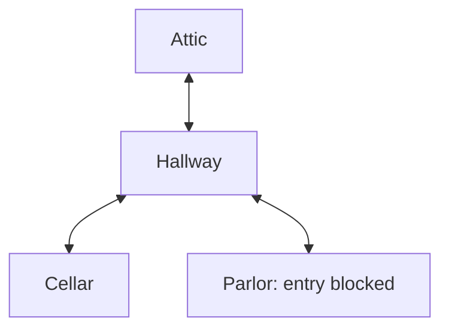

# Act advancement and location connections

Research and design recommendation for [#55](https://github.com/joeloverbeck/arkham-unfolded/issues/55), 2026-11-01. The inspected baseline is `ef6daf2e212d1499c6a5b6579faf9214045a19a2` plus the local corrections Joel has now accepted, including the restored harm-token positions. This investigation changes documentation only. It does not activate a new gameplay scope, publish the accepted patch, or close #55.

The immediate outcome is to make the existing Act 1 endpoint understandable without revealing its reverse early, and make the resulting four-location map readable. The incumbent offers the reverse prematurely, applies advancement in one transition, and draws manually positioned locations without links. Research closes with a source-backed implementation recommendation; aesthetic acceptance still needs the actual native result. No generalized story engine, graph-layout framework, new dependency or full-scenario continuation is proposed.

Joel subsequently accepted these recommendations and instructed proceeding. The [implementation activation in ADR 0002](../adr/0002-persistent-table-areas.md#act-reveal-and-location-connections) records the bounded candidate and verification scope; the research findings below remain the source evidence for that work.

Consulted: `PURP-1`–`PURP-6`, `WORK-1`–`WORK-6`, `EVID-1`–`EVID-10`, `SEM-1`–`SEM-2`, `REP-1`–`REP-3`, `AGENT-1`–`AGENT-5`, `OPS-1`–`OPS-7`, and `GOV-1`–`GOV-3`. The existing bounded-work and acceptance limits remain in force; this note is supporting evidence, not a second work queue.

## Confirmed implementation findings

| Concern | Current cause |
| --- | --- |
| Reverse visible too early | `src/party_tabletop/controls.rs:391` adds **Inspect reverse** whenever the selected source is Act 1. This also applies to pre-advancement replay moments and to selecting Act 1 before six clues. |
| No formal reveal | `src/party.rs:819` spends the clues, applies the entire map transition, records a summary and ends the attempt in one choice. No observation represents reading Act 1b. |
| Act 2 appears immediately | `src/party_tabletop/scene.rs:244` selects Act 2 from the Escaped endpoint; it never selects Act 1b for the scenario book. |
| Missing story in substitutes | The reverse artwork is already selected, but `src/party_tabletop/cards.rs:116` calls it “Trapped — reverse” and supplies only mechanical effects. The printed reverse is **The Door on the Floor**, including narrative. |
| Missing connections | `LocationView` in `src/party.rs:68` has name, card code, revealed status and clues, but no connection data. The scene draws no connection objects. |
| Placement provenance | `location_at` in `src/party_tabletop/scene.rs:7` is a name-to-coordinate switch. It does not use connections or a scenario-layout source. |

Inspection also needs a current-face boundary: `Context::inspect` checks catalog bounds, `exists(Source::Card)` accepts every known index, and `Action::Inspect` trusts that result. Remove the early menu entry and validate the target against the currently displayed observation at dispatch. A stale callback must not expose Act 1b, Act 2 or an unrevealed location face; replay must use its selected moment rather than knowledge from the live endpoint. Availability of an image in the local collection is not permission to display it.

The older Tony and Jacqueline modes do not implement this Act progression or reverse menu. Reuse their shared presentation conventions where appropriate without inventing progression in those modes.

## Rules and placement evidence

The pinned [Chapter One Rules Reference](https://cdn.svc.asmodee.net/production-fantasyflightgames/uploads/2026/09/ahc60_rules_reference_eng-compressed.pdf), pp3–4, places the reverse's resolution before the next Act becomes current. The [Learn to Play](https://cdn.svc.asmodee.net/production-fantasyflightgames/uploads/2026/09/ahc60_learn_to_play_web-1.pdf), p13, independently describes payment, flipping and resolving the reverse, setting the old Act aside, and exposing the next Act. A dedicated reading pause is a product recommendation for presenting that sequence, not a rulebook requirement for a modal.

The inspected Rules Reference has no separate general Act-back peeking prohibition. Do not invent one. Blocking pre-advancement inspection follows the reveal sequence and Joel's explicit requirement. It does explicitly prohibit reading an unrevealed location's other side (p14). Connections are determined from source-location connection symbols; a connected location can nevertheless be inaccessible because of an ability (pp15–16).

The original [Night of the Zealot campaign guide](https://cdn.svc.asmodee.net/production-fantasyflightgames/uploads/2026/09/night_of_the_zealot_campaign_guide.pdf), pp2–3, contains **no Gathering location-placement diagram**. Both pages were visually inspected. Its setup puts Study in play and sets the remaining locations aside. Act 1b introduces the four rooms without specifying coordinates. Learn to Play p13 illustrates Hallway-to-Cellar movement, not a complete Gathering arrangement. The [official legacy CDN guide](https://images-cdn.fantasyflightgames.com/filer_public/8d/30/8d308b73-92f1-4b1e-aa7f-ce39e8d79786/night_of_the_zealot_campaign_guide.pdf) provides an accessible publisher copy.

Git history confirms the arrangement was authored for presentation: `8a08cc9ddac849ca39380fb5df2d49d62129da89` placed Attic left, Cellar right, Parlor farther away and Hallway at the center. `ea13e81b9ecb5aa84aac90e7e401e3ef4f689869` widened and recentered it for the deeper surface. The inspected issue and preparation note specify the map transition but cite no spatial arrangement. The current coordinates therefore must not be described as manual-derived.

Original English card faces establish this endpoint graph, using the revealed Hallway and the unrevealed faces of the other three rooms:

This diagram communicates topology, not a source-prescribed physical arrangement. Hallway's red-square identity connects with the Attic blue triangle, Cellar brown plus and Parlor green diamond. Each room connects back to Hallway. There are no direct links between the three outer rooms. Derive each direction independently before combining reciprocal directions. Parlor remains connected while its unrevealed ability prohibits moving into it: do not delete the connection or turn the topology into a one-way route. Mark the blocked destination separately. The endpoint still stops before further movement under #55.

## Recommended Act presentation

Use a dedicated **Act advances** panel, distinct from optional Inspect:

1. Before payment, allow inspection of the current front only. Having six clues does not unlock the reverse.
2. Selecting the existing spend action commits payment and the Act reveal through save-before-install. Persist an advancement continuation and the hidden-information barrier. A failed save leaves the old position and does not display the reverse.
3. Display Act 1b with its real title, artwork, readable story and ordered effects. The scenario book shows that face; the prior map remains until resolution. Suppress ordinary gameplay during this required sequence. No automatic timer or dismiss-to-play path. Closing the application is safe and reopening resumes this reading point.
4. **Continue** acknowledges reading and applies the mandatory reverse effects through the normal persistence boundary: introduce the four rooms, discard Study enemies (none here), place the investigators in Hallway and reveal it, remove Study, then expose Act 2 and reach the existing endpoint. Costs and effects happen once. Reduced motion removes movement animation without skipping the reading point.
5. Record the reverse as its own replay moment. Reveal prevents undo to the prepayment state; Continue is narrative pacing, not a new strategic choice or an undo destination. Previously revealed Act content remains available through history afterward, without rerunning its effects.

This intentionally differs from the redundant **Finish test** stage removed in the accepted correction: it carries previously unseen narrative and instructions that the player needs time to read. Reuse inspection's card-image/text rendering, but give advancement its own lifecycle, title, focus handling and Continue control. A missing-art path needs the actual narrative meaning and effects from the verified source, not just a prepared-experiment summary.

A transient assignment to the existing inspector would be the smallest code change, but loses the reveal on restart and supplies no replay moment. An alternative is to complete all effects immediately and persist a presentation acknowledgement while concealing the final table. The explicit paid-reveal continuation is recommended because it presents the printed order directly and keeps future effect decisions from being silently pre-resolved. This is a local continuation for the represented Act, not a universal story interpreter.

The continuation must preserve validation rather than bypass it. In particular, the current clue-conservation check expects zero clues only at Escaped; the paid-reveal stage legitimately has zero clues while the old map remains. Existing moment/revision equality, location validity and immutable stored-history checks must remain coherent. Keep a documented compatible reader for known old records when introducing the new continuation protocol. Old Closing saves can enter the new sequence; old Escaped saves already applied all effects and must never pay or move again. Historical replay keeps its stored observations instead of retroactively inserting an event that was never recorded.

## Recommended connection visuals

Use low-profile, warm-brass paths with a narrow dark border on the tabletop. Give each actual connection direction a filled arrowhead: one for a one-way connection, two for a reciprocal pair represented by one path. Shape conveys direction independently of color. Keep the card artwork dominant, avoid continuous pulsing, and make the link meshes non-pickable. A small lock/restriction mark at Parlor's entrance can explain its blocked entry without changing the underlying arrows. These are proposed art-direction choices, not a researched aesthetic optimum.

Compute geometry from the current card transforms and explicit public connection data. Start with a straight path; use a shallow rounded bend only when needed to clear another object or an ambiguous crossing. Clip endpoints outside reserved location footprints, including the card rectangle, **all** standee slots, and captions/counters. Reserving empty standee slots keeps paths stable as investigators move. The current Parlor caption sits on the Hallway–Parlor centerline, so card-only clipping is insufficient. Caption margins target the supported normal Scenario viewing range; arbitrary manual orbit or zoom can naturally cause occlusion. Route in the tabletop plane; orbiting the camera must not move cards or reroute the map.

Arrowheads need bounded sizes relative to available length; short paths must not produce intersecting heads. Recompute on topology, card-transform or footprint changes, not every frame. Test a small deterministic set of boundary ports and unobstructed straight/rounded-dogleg paths for this finite map. A fit failure must be visible during development rather than silently suppressing a real connection.

The existing Bevy dependency suffices. Its [custom mesh example](https://bevy.org/examples/3d-rendering/generate-custom-mesh/) demonstrates triangle meshes and material assignment; the installed pinned `bevy_mesh 0.20.0` source confirms those APIs. Its [3D gizmos example](https://bevy.org/examples/gizmos/3d-gizmos/) demonstrates one- and double-ended arrow geometry, but is a visual-debugging API rather than a required final style. No new image asset or graph dependency is needed for the recommended mesh approach.

[Graphviz's direction](https://graphviz.org/docs/attrs/dir/), [boundary clipping](https://graphviz.org/docs/attrs/headclip/), [obstacle margin](https://graphviz.org/docs/attrs/esep/) and [routing](https://graphviz.org/docs/attrs/splines/) documentation support separating those concerns. They are design precedents, not a recommendation to embed Graphviz. Exact colors, widths and native readability remain untested until a candidate is rendered.

## Placement policy and simplest credible alternative

Use a hybrid placement policy:

- Honor scenario-required relative positions. Where the manual offers a suggested arrangement, use it as the default and identify it as suggested rather than mandatory.
- Where no arrangement is supplied, give the finite scenario explicit relative hints and compute coordinates from connection structure, occupied footprints and clearances. For this four-node star, Hallway is the only hub. A coherent proposed orientation is Attic above Hallway, Cellar below and Parlor to one side in the normal Scenario view, all on the tabletop plane; that orientation is our presentation choice, not vertical elevation. Exact distances follow card/standee/label footprints and the usable scenario surface, not four unrelated coordinate literals.
- Keep the resulting positions stable through ordinary play and camera movement. Preserve existing anchors when adding locations where possible. Always derive links from rules data; proximity never creates a game connection.

This is programmatic placement with small scenario-specific inputs. The least-complex alternative is retaining the current authored slots and adding adaptive arrows; it is valid for the current topology but does not explain the existing orientation or account explicitly for full footprints. Prefer the small relative-layout calculation for a reviewable rationale and controlled spacing. Do not add force-directed animation or a general graph solver for this four-location case. A more general deterministic fallback should be evaluated only against a real later supported map that defeats prescribed layouts and local hints. [ELK's constraint documentation](https://eclipse.dev/elk/blog/posts/2023/23-01-09-constraining-the-model.html) illustrates that preserving prior positions/model order still requires explicit policy even with a solver.

## Verification that an implementation would need

Use the existing production control, sixth-clue and continuity seams: prepayment and early-replay reverse refusal; paid reveal with no Act 2 yet; failed payment/Continue saves; close/reopen at the reading point; no reveal-crossing undo; complete effects once; old Closing/Escaped compatibility; and stored replay without changing the live session. Do not broaden gameplay beyond #55's existing endpoint.

Connection checks must independently assert the three reciprocal pairs, no outer-room pairs, Parlor's separate restriction, and no information from hidden faces. Exercise unequal/rotated bounds, changed spacing, an obstructing standee or caption, reversed input order, and short/no-fit paths. Native evidence must show readable arrows and the complete paid Act-reveal sequence with artwork and substitutes through the actual production registration. Static research establishes neither final visual quality nor owner acceptance. No runtime tests or native launches were performed for this research-only change.

## Source identities

The source archive remained read-only; no artwork or font payloads enter Git. PDF evidence is in existing `/tmp/party-rules-reference-agent.pdf` and research downloads `/tmp/arkham55-original-campaign.pdf`, `/tmp/arkham55-learn-to-play.pdf`. These temporary paths are audit evidence, not new runtime dependencies or a durable-backup claim.

| Source | SHA-256 |
| --- | --- |
| Pinned Chapter One Rules Reference | `14823bd23033a857efd78b5c30d2e0fa5eb0cf004675573bf6e8c6698777df4a` |
| Original Night of the Zealot guide | `132bb78a2c70245d2aa8037bab39784f42431b01c02ffa9d5b44d2edc10e13fb` |
| Publisher-linked Learn to Play | `f82790f81af3731f11f0a7ddc267feb0644b47d20842a973f1023de709568ab0` |
| Act 1b `01108`, variant `79184f89d96cf371` | `c2a27ffffc807b7f2eea7c6da91a41808c4585ff7a41e74771be88679e606491` |
| Hallway revealed `01112`, variant `e59fa22742aa5070` | `5af07e38456e65821dc1ecd78e7a51728c23806167d9cf7bd3347b76b51e8bba` |
| Attic unrevealed `01113`, variant `800834c2e07131c2` | `23748e8a6e3d88723cc99cc61ec675045075ad40b2536ba3c0d21eeb1ad7da1c` |
| Cellar unrevealed `01114`, variant `96eba9154b6a3047` | `c4ec5587fb3e58ce07060303f32a19c8526b50b480beac3ded82f81420836a84` |
| Parlor unrevealed `01115`, variant `954f54490565c9d9` | `e81df0029e99ff6279427c49769d2c6255b82a59e45aeef60b104bf822e23a89` |

Card paths are under the accepted archive's `images/cards/official/en/night_of_the_zealot/Core/`, in the matching code/title and variant directories. These are original English card identities already selected by the project, not Return To or Chapter Two replacements.
